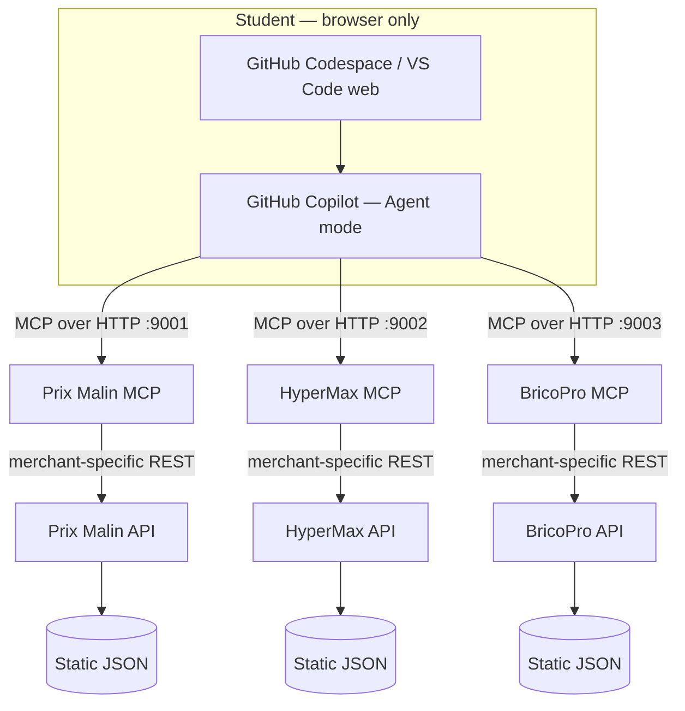

# GitHub Workspace — implementation brief (not implemented yet)

> **Audience:** workshop organizer / implementer.  
> **Status:** implemented. The 3 REST APIs and 3 MCP servers run **inside each student's Codespace**, started automatically. A rehearsal on a fresh GitHub account is still required (§7).  
> **Non-negotiable:** participants use only a web browser and a standard GitHub account. No local install, `git clone`, terminal commands, or paid subscription should be necessary (free-plan quotas are assumed sufficient).

## 1. Target experience

1. Student opens the organizer's GitHub repository in a browser.
2. **Code → Codespaces → Create codespace on main** opens browser-based VS Code.
3. GitHub Copilot Chat is available; the student selects **Agent** mode.
4. Initially, the agent sees **only Prix Malin's MCP server**.
5. The student pastes a prepared workspace MCP configuration to add **HyperMax**, then **BricoPro**. No code is written.
6. The student runs business prompts; the agent invokes tools from three independent MCP servers (separate processes, separate ports).
7. The student explicitly explores two **prompts** from Prix Malin and two **resources** from BricoPro.

**Must be tested:** Codespaces browser + Copilot Agent + Streamable HTTP MCP on localhost + resources/prompts using a fresh GitHub Free account. Do not infer successful compatibility from configuration syntax alone.

## 2. Architecture and responsibility boundaries



- **The Codespace runs** all six services (three REST APIs on ports 8001–8003, three MCP facades on 9001–9003) as separate processes, started by `scripts/start.sh`. Nothing is hosted by the organizer.
- **Each merchant** has different API routes, field names, price encoding and business rules. See `prix-malin/`, `hypermax/`, and `bricopro/`.
- **Each MCP facade** exposes that merchant's capabilities; it does *not* query competitors.
- **The agent** performs cross-merchant reasoning; MCP itself is not a comparison algorithm or automatic common business schema.
- **No commerce transaction:** no cart, order, payment, reservation, login or mutable inventory. Merchant backends remain stateless and read-only.

## 3. Repository structure

```text
workshop-mcp-marchands/
├── README.md, WORKSHOP_FLOW.md, GITHUB_WORKSPACE_SPEC.md, REVIEW.md, TEST_PROMPTS.md
├── requirements.txt, pyproject.toml
├── prix-malin/ | hypermax/ | bricopro/
│   ├── README.md          # merchant REST + MCP contract (French)
│   ├── donnees.json       # immutable fixture
│   ├── api.py             # FastAPI REST API, merchant-specific routes
│   └── mcp_server.py      # MCP server (Streamable HTTP), calls only its own API
├── tests/                 # pytest: APIs + MCP servers, in memory, no network
├── scripts/start.sh       # (re)starts the 6 processes, logs in /tmp/workshop-logs
├── scripts/smoke.py       # real HTTP MCP check: 9 tools / 4 resources / 4 prompts
├── agent-inspector/       # instructor-only demo: narrated agent harness + web UI (not started in Codespaces)
├── .devcontainer/devcontainer.json
├── .vscode/mcp.json       # stage 1: Prix Malin only
├── .vscode/tasks.json     # Run Task: servers, smoke test, MCP demos, stage switch, tests
└── .workshop/mcp-stages/  # 01, 02, 03: complete config snapshots
```

## 4. Codespaces configuration

`.devcontainer/devcontainer.json` uses `mcr.microsoft.com/devcontainers/python:3.12`, installs `requirements.txt` once (`postCreateCommand`) and runs `scripts/start.sh` on every start (`postStartCommand`). Copilot extensions are pre-installed inside the Codespace. Ports 8001–8003 are forwarded so students can open each API's `/docs` in the browser.

**Acceptance criteria:** browser editor ready, Copilot authenticated, Agent mode accessible, `python scripts/smoke.py` prints `(9, 4, 4)`, Prix Malin listed in the tools picker. On first start VS Code may ask to trust the workspace MCP server: these are local, read-only servers from this repository.

## 5. MCP config and staged activation

`.vscode/mcp.json` (root key `servers`, type `http`) starts with Prix Malin only:

```json
{
  "servers": {
    "prix-malin": { "type": "http", "url": "http://localhost:9001/mcp" }
  }
}
```

**Stage 2:** copy `.workshop/mcp-stages/02-add-hypermax.json` over `.vscode/mcp.json`. **Stage 3:** same with `03-add-bricopro.json`. All six services run from the start; the stages only control what the agent can *see*. After each save, use **MCP: List Servers** to start/restart, and **MCP: Reset Cached Tools** if the tool list is stale.

**Why staged files?** Start with one discoverable supplier and reveal new capabilities without asking students to edit JSON.

**MCP implementation:** Streamable HTTP, stateless, JSON responses, `/mcp` per supplier. All tools are annotated read-only. Outputs carry `merchant`, `price_eur`, `stock_packs` and the merchant's original identifiers; unknown identifiers return explicit tool errors.

## 6. MCP capability contracts to check

| Server | Tools | Resources | Prompts | Distinctive capability |
|---|---:|---:|---:|---|
| Prix Malin | 3 | 1 | **2** | Arrival/stock feasibility; two reusable low-cost prompts |
| HyperMax | 3 | 1 | 1 | Organic meat and generalized product search |
| BricoPro | 3 | **2** | 1 | Equipment compatibility; two separate guides |
| **Total** | **9** | **4** | **4** | 3 independent REST APIs, 3 independent MCP servers |

Tools can be selected by the agent; **resources** are best demonstrated explicitly through **MCP: Browse Resources** / **Add Context → MCP Resources**; **prompts** are selected explicitly with the applicable chat slash command. Do **not** promise Copilot will autonomously open a resource or execute a supplier prompt just because it is exposed.

## 7. Organizer preflight (complete before publishing the student link)

- [ ] `pytest -q` passes (CI runs it on every push).
- [ ] In a fresh Codespace, the six services start without manual action and `python scripts/smoke.py` prints `(9, 4, 4)`.
- [ ] Exactly **9 tools / 4 resources / 4 prompts** available in the intended client; resource text and prompt arguments usable.
- [ ] Prices remain in **EUR**, with clear unit/pack and stock semantics; no silent cent/euro mismatch.
- [ ] Organic products only at HyperMax; chips not at Prix Malin; poultry skewers out of stock at Prix Malin.
- [ ] Cola cheaper at HyperMax; same compact BBQ model cheaper at BricoPro; equipment compatibility verifiable.
- [ ] 16:30 permits all stores; 18:30 excludes Prix Malin but leaves HyperMax and BricoPro open (Europe/Paris, all days for this scenario).
- [ ] A **fresh personal GitHub Free account** can launch Codespaces + Copilot Agent + the HTTP MCP servers without desktop software.
- [ ] Activation of Stage 2 and Stage 3 actually changes tool visibility and supports cross-provider answers.
- [ ] Each attendee can open the repo and create a Codespace; link and access permissions tested.
- [ ] Run every prompt of `TEST_PROMPTS.md` in Copilot Agent and check the expected answers.
- [ ] Run one full rehearsal from a clean Codespace; prepare instructor fallback (screen-sharing/tool traces) if connectivity fails.
- [ ] Confirm classroom browser permissions, GitHub sign-in and available usage quotas in advance (assumed sufficient for this exercise).

**Failure policy:** if a MCP is offline, use instructor demonstration/traces; never claim that a simulated output was executed live. Avoid user secrets and personal information in prompts.

## 8. Definition of done

One student, using only a browser, can reach the environment in **under 5 minutes**, execute a merchant tool, activate two more MCP servers, invoke **both** Prix Malin prompts, inspect **both** BricoPro resources, and produce a reasoned cross-merchant plan that respects budget, time, stock, organic and equipment constraints.

### Official reference docs

- [GitHub — Develop in a Codespace](https://docs.github.com/en/codespaces/developing-in-a-codespace/developing-in-a-codespace)
- [GitHub — Copilot in Codespaces](https://docs.github.com/en/codespaces/reference/using-github-copilot-in-github-codespaces)
- [VS Code — MCP configuration reference](https://code.visualstudio.com/docs/agents/reference/mcp-configuration)
- [VS Code — MCP tools, resources and prompts](https://code.visualstudio.com/api/extension-guides/ai/mcp)
