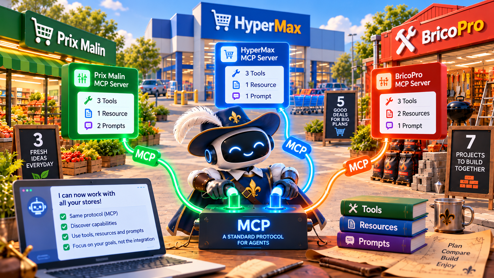
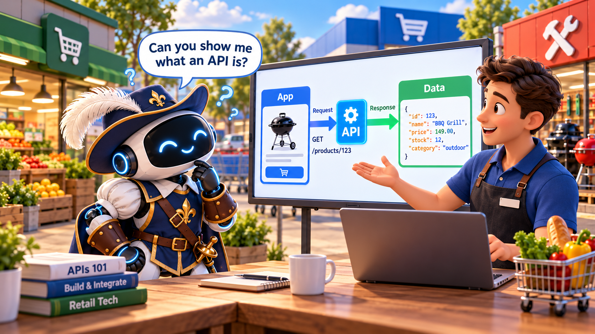
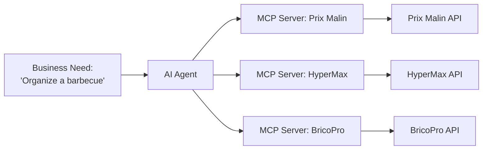
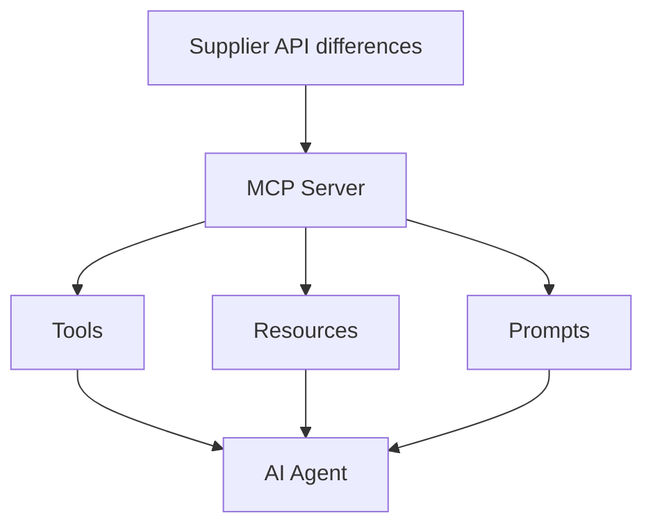
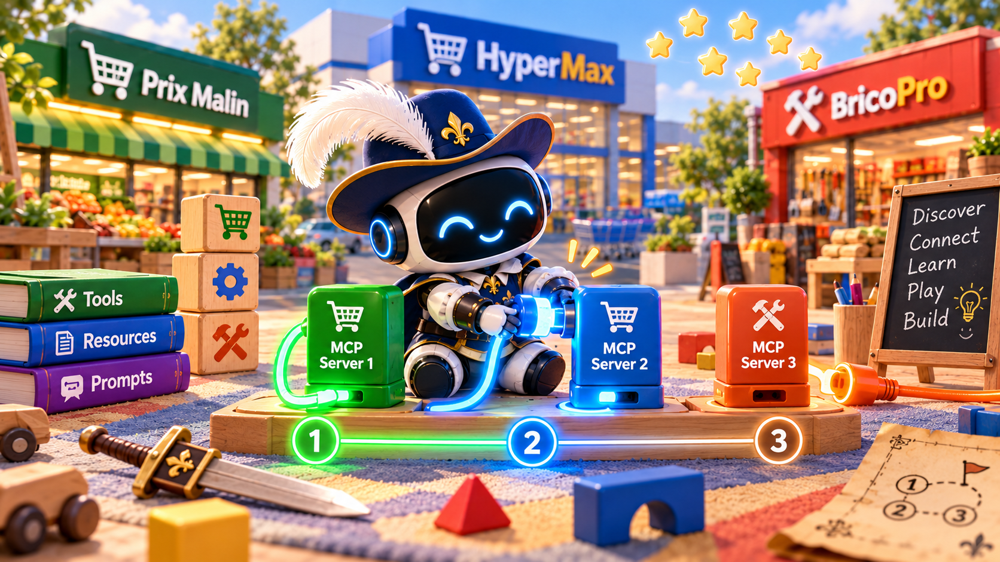
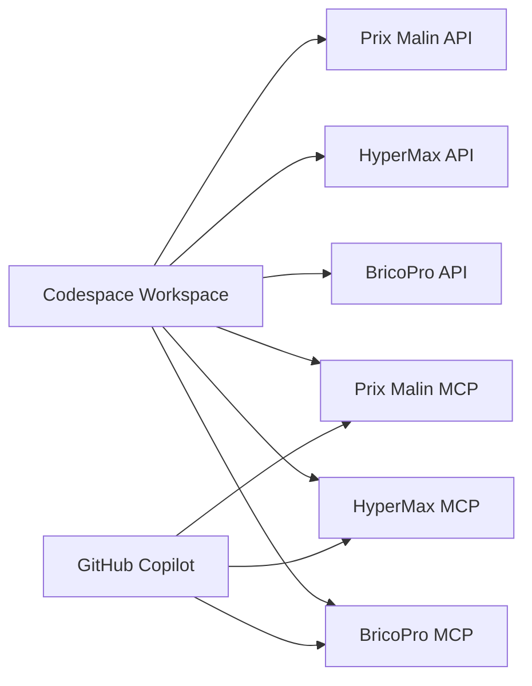
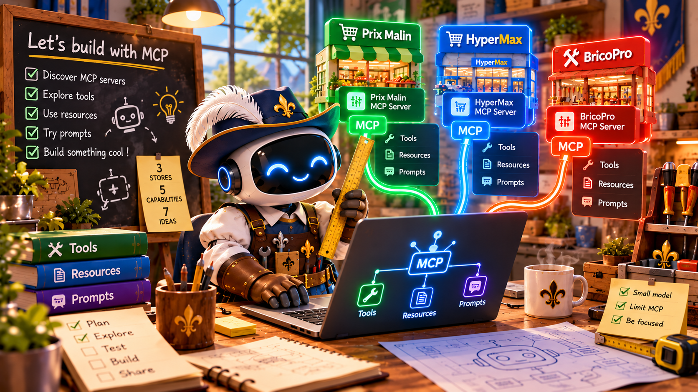

# MCP Workshop — Why Business People Should Care

> **Goal:** understand the **business value** of MCP by playing with a realistic multi-supplier setup.

---

## 1. What this project is about

### The short version

We simulate a small business problem:

> “Help me organize a barbecue with the best combination of price, availability, opening hours, and equipment.”

To solve it, an AI agent will need to talk to:

- **Prix Malin** → cheap food, limited stock
- **HyperMax** → broad catalog, food + non-food
- **BricoPro** → barbecue gear and DIY only

### Why this is interesting

The business lesson is not “wow, AI”.

The business lesson is:

- **data exists in silos**
- **each provider exposes things differently**
- **integration is expensive**
- **standards reduce friction**
- **MCP helps an agent use tools faster and more reliably**

---

## 2. Remind my what an API is

### A simple definition

An **API** is a way for software to ask another software for something.

Examples:

- “Give me your products”
- “What is the price of sausages?”
- “Are you open at 18:30?”
- “Is this barbecue compatible with charcoal?”

### Why robots prefer APIs over graphical interfaces

Humans like interfaces.

- buttons
- menus
- images
- forms
- pages

Robots do **not** want that.

Robots want:

- structured data
- predictable responses
- stable fields
- less noise
- less guessing

### In one sentence

> A browser is made for eyes. An API is made for systems.

### Funny-but-true business argument

A modern web page is often ridiculously heavy for a robot that only wants one fact.

According to **HTTP Archive**, the **median desktop page** in Sep 2026 weighs about **2994 KB** and triggers **76 requests**.

So yes, making a robot open a full web page just to fetch the price of sausages is a bit like sending a forklift to deliver one croissant.

Source: [HTTP Archive — Page Weight](https://httparchive.org/reports/page-weight?trk=article-ssr-frontend-pulse_little-text-block)

---

## 3. What is MCP?

### One-paragraph definition

**MCP** means **Model Context Protocol**. It is an open protocol that lets tools, resources, and prompts be exposed in a standard way to AI systems. Instead of hard-coding a separate integration for every service, an agent can connect to an MCP server, discover what is available, and use those capabilities with a more consistent contract.

### Why it is cool

Because it standardizes the **way AI connects to capabilities**.

That means:

- less custom glue
- clearer tool discovery
- easier reuse
- more portable integrations
- better agent experience

### Visual model

### The key idea

> APIs expose business data. MCP exposes **AI-usable capabilities** on top of that data.

---

## 4. Workshop components — the three suppliers

### Prix Malin

**Think:** discount grocery store.

- low prices on classic meat and staples
- limited catalog
- variable arrivals
- sometimes out of stock
- open **09:00–17:00**

**Business personality:** cheap, useful, unreliable on variety.

**Good for:** basic barbecue food at low cost.

---

### HyperMax

**Think:** big hypermarket.

- large catalog
- food + non-food
- open long hours
- only supplier with **organic meat**
- open **08:00–21:00**

**Business personality:** broad selection, generally more expensive, but competitive on some items.

**Good for:** one-stop shopping and special constraints like organic.

---

### BricoPro

**Think:** DIY and outdoor specialist.

- no food at all
- barbecues, charcoal, fire starters, accessories
- specialist products
- often cheaper than HyperMax for equipment
- open **07:00–19:00**

**Business personality:** expert, focused, useful for gear.

**Good for:** turning “we have sausages” into “we can actually cook them”.

---

## 5. MCP on top of the suppliers

Each supplier has:

- its **own API**
- its **own data structure**
- its **own naming style**
- its **own business rules**

So we add **one MCP server per supplier**.

### What MCP does here

It smooths the ugly parts.

It does **not** make the suppliers identical.

It makes them easier for an agent to use.

### Example

The raw APIs are different.

- one API may use `sku`
- another may use `product_id`
- one may expose price in cents
- another may expose price in euros
- one may call stock `availableLots`
- another may call it `inventory`

The MCP layer translates that into tools the agent can understand.

### What you should notice

- the agent does not need to know every API detail
- the MCP server exposes discoverable capabilities
- different suppliers can still have different business logic
- one standard interface creates leverage

---

## 6. Recap — API + MCP

### If you remember only this

| Layer | Role | Example in this workshop |
|---|---|---|
| **API** | Gives access to raw business data | products, opening hours, product details |
| **MCP** | Makes capabilities easier for agents to discover and use | tools, resources, prompts |
| **Agent** | Uses the capabilities to solve a goal | organize a barbecue |

### Short formula

> **API = access**  
> **MCP = agent-friendly access**  
> **Agent = decision layer**

---

## 7. Demo time — `agent-inspector`

Let's give a small local LLM access to MCP tools and verify that it can perform tasks efficiently.

---

## 8. Ok great — but where do I find MCP servers?

- **MCP home**: [modelcontextprotocol.io](https://modelcontextprotocol.io)
- **Official MCP Registry**: [registry.modelcontextprotocol.io](https://registry.modelcontextprotocol.io)
- **Registry docs / API**: [Official Registry docs](https://registry.modelcontextprotocol.io/docs)
- On community catalogs and lists

---

## 9. Why GitHub matters here

GitHub is not just where code sleeps.

For this workshop, GitHub is the operational base.

### What GitHub does for us

- hosts the workshop material
- will host the API code
- will host the MCP server code
- allows participants to fork the project
- allows participants to create their own workspace in the browser
- provides access to **GitHub Copilot** for the practical part

### Business translation

GitHub is the shared working environment.

That means less setup pain and more time spent learning.

---

## 10. Practical setup — what participants must do

1. **Fork** the repository
2. **Open** the fork in GitHub
3. **Create a workspace** (Codespace)
4. **Wait** for the environment to start
5. **Open GitHub Copilot Chat**
6. **Use the prepared instructions**

---

## 11. What starts inside the environment

When the workshop environment starts, it will start:

- all **three supplier APIs**
- all **three MCP servers**
- the configuration needed to let Copilot see them
- the sample assets and workshop documents

### Visual summary

---

## 12. What we will do in practice

Let's use **GitHub Copilot** to interact with the MCP servers and explore what the agent can do.

### Important workshop rules

To keep the demo understandable:

- **limit the MCP servers available in context** when needed
- start with **one MCP**, then two, then three
- use a **small model** first
- keep the prompts business-oriented
- observe how the answers change as more capabilities are added

### Suggested practice path

#### Round 1 — One supplier

Prompt:

> Find the cheapest meat and drinks for a barbecue for 10 people.

Goal:

- see tool use
- see limited answers
- see supplier constraints

#### Round 2 — Two suppliers

Prompt:

> Compare Prix Malin and HyperMax for a barbecue for 10 people with a budget of 80 euros.

Goal:

- compare prices
- compare opening hours
- discover that one supplier is not always cheaper on every item

#### Round 3 — Full situation

Prompt:

> Organize a barbecue for 10 people with a budget of 150 euros. I need meat, one organic option, drinks, chips or fries, a barbecue, charcoal, and basic accessories. We shop at 16:30. Optimize the purchase plan and tell me what to buy in each store.

Goal:

- multi-supplier orchestration
- bio constraint
- equipment + food mix
- stock and hours reasoning

#### Round 4 — Constraint shock

Prompt:

> Same task, but shopping happens at 18:30 instead of 16:30. What changes?

Goal:

- force the agent to reason with opening hours
- see Prix Malin disappear from the plan

### Final line

> MCP is not “just another tech thing”.  
> It is a way to make capabilities easier to connect, easier to reuse, and easier to scale.

And yes, our robot mainly wanted sausages.  
But accidentally learned platform strategy.
