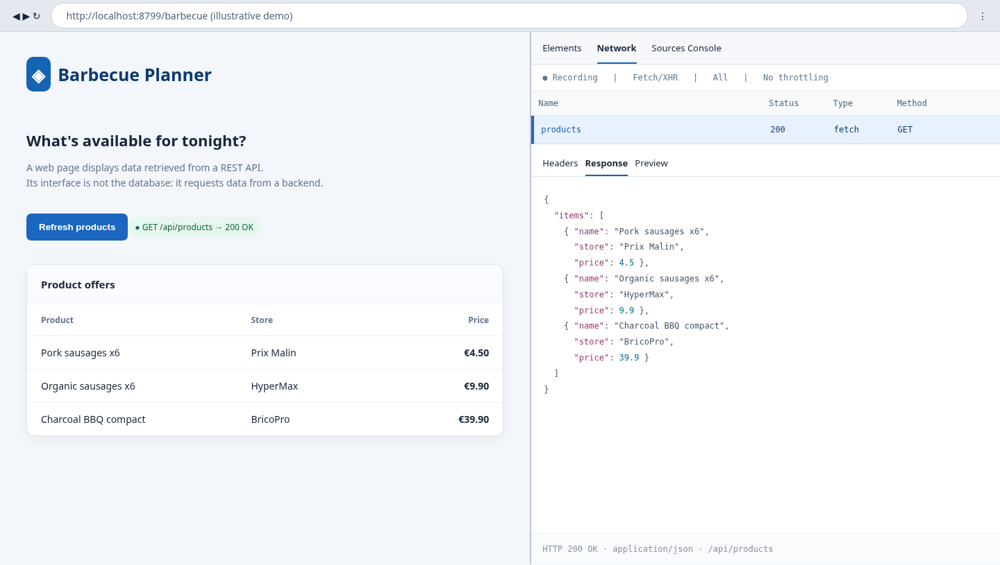
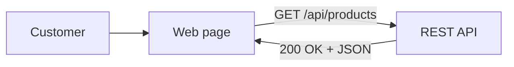
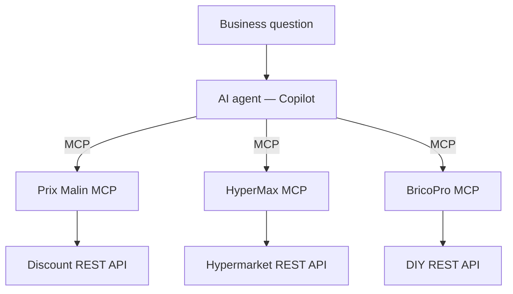

# MCP in Business: the 3-Supplier Barbecue Challenge

**65-minute interactive workshop · Master’s-level business / tech audience**  
**Format:** 15% framing, 70% hands-on decisions, 15% discussion. **Bring:** browser + GitHub account. **Install:** nothing.

> **Challenge:** Can an AI agent assemble a better purchasing plan when it can discover capabilities from three independent suppliers?

## 01 — A 90-second API refresher (0–6 min)

**API = a defined way for software to request data or actions from another system.** A webpage is the visible interface; API calls often supply its data.

*Illustrative browser screenshot (mock Network panel, not a genuine Chrome DevTools capture). It shows the request–response concept; the three workshop merchants each have their **own** API, not the single combined endpoint shown here.*

**Ask the room:** “Who owns the data? Does the webpage contain the products, or ask another system for them?”  
**Live optional:** open browser Developer Tools → Network → Fetch/XHR → reload any instructor-controlled demo webpage → click an API request → Response. Avoid exposing real customer data.

## 02 — Why MCP? (6–12 min)

- **API:** the supplier exposes its system.
- **MCP:** the supplier makes tools, resources and prompts discoverable by an AI client.
- **Agent:** selects tools, weighs evidence, explains trade-offs. **MCP does not make purchasing decisions by itself.**

**Three primitives:** `Tools = do / query` · `Resources = reference context` · `Prompts = reusable starting workflows`.

**Instructor demo (optional):** show the [MCP Agent Inspector](agent-inspector/README.md) on the projector — no MCP, then one server, then two — so students see that the model is stateless and the harness does the calling.

## 03 — Guided lab: one supplier (12–23 min)

**Open the organizer's GitHub repo → Code → Codespaces → Create codespace → Copilot Chat → Agent.** Stage 1 exposes **Prix Malin only**.

**Prompt to paste**

> I'm planning a barbecue for 10 people. What food and drinks can Prix Malin offer? Include pack sizes, stock, prices and total cost. Identify items I cannot buy there. Use supplier tools rather than guessing.

**Then try**

> I need 12 chicken skewers, fries and chips. What is actually possible at Prix Malin? Distinguish out of stock from not sold.

**Ask the room:** “Would a cheaper price still matter if the product cannot be purchased?”

## 04 — Add a competitor (23–34 min)

Open `.workshop/mcp-stages/02-add-hypermax.json`, copy its **entire** content to `.vscode/mcp.json`, save, start/restart MCP servers if needed. Inspect the tools picker.

**Prompt to paste**

> Compare Prix Malin and HyperMax for regular sausages, fries and cola. Show comparable pack sizes, unit prices, stock and opening hours. Which supplier is cheaper for each item? Cite the supplier tool results.

**Second challenge**

> I want organic sausages for six people. Which supplier can satisfy this requirement? Do not treat regular meat as organic.

**Ask the room:** “Does ‘discount’ mean ‘always cheapest’?” (Check cola.)

## 05 — Add a specialist (34–45 min)

Replace the MCP config with `.workshop/mcp-stages/03-add-bricopro.json`. Verify **three suppliers** in the tools picker.

**Prompt to paste**

> Find a charcoal barbecue suitable for 10 guests, plus fuel, firelighters and a cooking tool. Compare equipment at BricoPro and HyperMax. Check accessory compatibility; distinguish documented compatibility from assumptions.

**Ask the room:** “Should an AI infer product compatibility from a product name?”

## 06 — Beyond tools: resources & prompts (45–53 min)

**Prove multiple prompts exist on one server:** invoke these **two distinct Prix Malin MCP prompts** using the Copilot chat slash-command picker (type `/`, find the server prompt, fill its parameters):

- `find_lowest_cost_meal` — 10 guests · €40 · 16:30.
- `adapt_to_arrivals` — “chicken skewers, fries, chips” · 16:30.

**Prove multiple resources exist on one server:** **MCP: Browse Resources** (or **Add Context → MCP Resources**) → open/attach both BricoPro resources:

- `bricopro://guides/barbecue` — choosing the appropriate grill.
- `bricopro://guides/compatibilite` — documented accessories and fuel compatibility.

**Ask the room:** “When is a reference document more useful than an action? When is a reusable prompt more useful than starting from scratch?”

> **Important:** prompts and resources are **not automatically run** just because the server exposes them. Actively select them for this exercise. UI labels/slash-command naming may vary by VS Code version.

## 07 — Team challenge: optimize the plan (53–63 min)

**Work in pairs.** Compare solutions and defend trade-offs. The facilitator decides the winner based on feasibility and evidence, not only price.

**Main brief — copy/paste**

> Plan a charcoal barbecue for 10 people. Budget: **€150 total, including the grill**. Shopping time: **16:30 (Europe/Paris)**. Include at least **10 meat portions**, with **at least one organic pack**, fries, chips, drinks, charcoal, firelighters and a cooking tool. Choose equipment whose stated capacity covers 10 guests. Use the three supplier MCPs. Check stocks, opening hours, pack sizes and compatibility. Present a shopping list grouped by merchant, arithmetic for the total, and any assumptions or unmet requirements. Do not invent products or promise purchases.

**Optional constraints — add only after the first answer:**

- **Time switch:** “Change shopping time to 18:30. Recalculate. Which supplier is now closed?”
- **Budget shock:** “Reduce the limit to €120. Keep all requirements or explain precisely why this is impossible from current stock/prices.”
- **Responsible sourcing:** “All meat must be organic. What changes in cost and supplier choice?”

**Assessment:** feasible > correct evidence > transparent total > cost efficiency. Missing data must be declared, not fabricated. Do not assume travel time or geographic distance; location and delivery are outside these APIs.

## 08 — Debrief (63–65 min)

- **Business value:** new suppliers added without redesigning the agent's business question.
- **Limits:** stale data, model errors, missing catalog items, tool trust, no checkout.
- **One question:** “If this were real procurement, what safeguards would you need before letting the agent buy?”

---

### Facilitator quick checklist (not a slide)

- Show API ↔ MCP ↔ agent once, then let the room experiment; avoid narrating JSON schemas.
- Before class, create a Codespace and run every prompt of `TEST_PROMPTS.md`. If a server is down during class: **Terminal → Run Task → Servers: restart all**.
- Keep a prepared trace/screenshare fallback for service or Copilot failures.
- Observe actual tool calls before praising a result: fluent text alone is not proof of integration.
